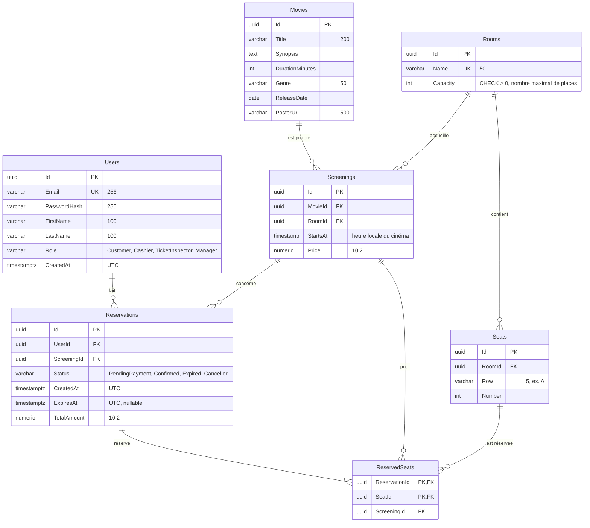

# Schéma entité-relation – Grand Cinema

Schéma de la base PostgreSQL, tel que créé par la migration `InitialSchema`. Le script SQL correspondant est [schema.sql](schema.sql).

## Tables

| Table | Rôle |
|---|---|
| `Users` (utilisateurs) | comptes des clients et du personnel, avec leur rôle |
| `Movies` (films) | catalogue des films projetés |
| `Rooms` (salles) | salles du cinéma et leur capacité maximale |
| `Seats` (places) | places physiques d'une salle (rang et numéro) |
| `Screenings` (séances) | projection d'un film dans une salle à une heure donnée, avec son prix |
| `Reservations` (réservations) | réservation d'un utilisateur pour une séance, avec son statut et son montant |
| `ReservedSeats` (places réservées) | places occupées par une réservation pour une séance |

L'énoncé cite cinq tables. `Rooms` et `ReservedSeats` sont ajoutées pour respecter la troisième forme normale : la salle et sa capacité ne sont pas répétées dans chaque séance, et une réservation de plusieurs places ne répète pas les informations de la réservation.

## Contraintes clés

| Contrainte | Table | Rôle |
|---|---|---|
| `UNIQUE (ScreeningId, SeatId)` | `ReservedSeats` | **une place ne peut pas être vendue deux fois pour une même séance**, même en cas de bug applicatif ou de requêtes simultanées |
| `PRIMARY KEY (ReservationId, SeatId)` | `ReservedSeats` | une réservation ne contient pas deux fois la même place |
| `UNIQUE (RoomId, Row, Number)` | `Seats` | une place n'existe qu'une fois dans une salle |
| `UNIQUE (Email)` | `Users` | un compte par adresse e-mail |
| `UNIQUE (Name)` | `Rooms` | deux salles ne portent pas le même nom |
| `CHECK (Capacity > 0)` | `Rooms` | une salle a au moins une place |

Index non uniques : `Screenings (RoomId, StartsAt)` pour retrouver les séances d'une salle, ainsi que les index créés automatiquement sur les clés étrangères.

## Suppressions

Toutes les clés étrangères sont en `RESTRICT` : on ne peut pas supprimer un film, une salle, une place, une séance ou un utilisateur encore référencé. Seule exception : `ReservedSeats → Reservations` est en `CASCADE`, car supprimer une réservation libère ses places.

À l'expiration ou à l'annulation, les lignes de `ReservedSeats` sont supprimées pour libérer les places, et la réservation garde son statut (`Expired`, `Cancelled`) pour l'historique.

## Règles vérifiées dans le code, pas en base

- Une place réservée doit appartenir à la salle de la séance : une clé étrangère ne peut pas l'exprimer. La règle est vérifiée dans le gestionnaire de réservation et couverte par un test.
- Le `ScreeningId` d'une place réservée doit être celui de sa réservation. Il est vérifié dans le gestionnaire de réservation (une clé étrangère composite vers `Reservations (Id, ScreeningId)` permettrait de le garantir en base).
- Le nombre de places d'une salle ne dépasse pas sa `Capacity` : une contrainte `CHECK` ne peut pas compter les lignes d'une autre table. La règle est vérifiée par le gestionnaire qui crée les places.
- L'adresse e-mail est enregistrée en minuscules, pour que l'unicité ne dépende pas de la casse.

## Dates

- `StartsAt` est en `timestamp without time zone` : c'est l'heure affichée au cinéma (18 h 30 à Paris), sans conversion.
- `CreatedAt` et `ExpiresAt` sont en `timestamp with time zone` et toujours écrits en UTC : ce sont des instants techniques.
- `ReleaseDate` est en `date` : seul le jour compte.
